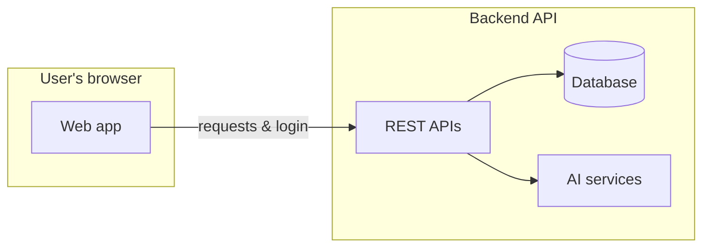
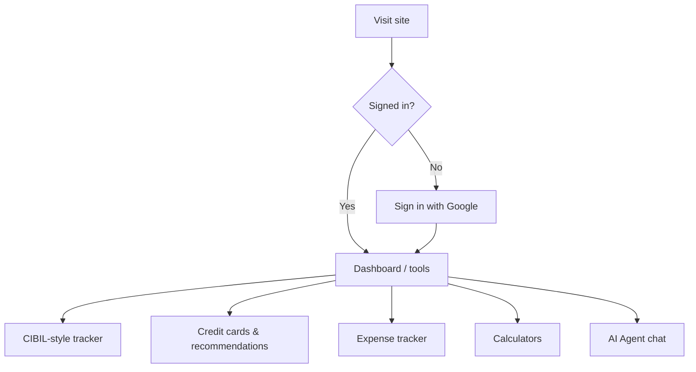

# Cibilize — Project Overview (Presentation Summary)

**What it is:** Cibilize is a personal-finance web application focused on **Indian credit behavior** (similar ideas to CIBIL-style scoring). It helps users explore **credit cards**, estimate **credit health**, track **spending**, run common **money calculators**, and chat with an **AI assistant** about cards and related topics.

---

## Big-picture architecture

The product splits into two main pieces that work together:

1. **Web app (frontend)** — What people see and click: screens, forms, charts, and the chat agent.
2. **Backend API** — Secure server that talks to the database, handles login, stores expenses, serves credit-card data, and runs AI-powered score analysis.

**Main technologies (plain English):**

| Layer | What we use | Role |
|--------|-------------|------|
| Frontend | React, TypeScript, Vite | Fast, modern interactive UI |
| Styling & UI | Tailwind CSS, Radix-based components | Consistent layout and accessibility-friendly controls |
| Data on the client | TanStack Query | Loads and refreshes server data smoothly |
| Backend | Node.js, Express | Handles routes, security, and business logic |
| Database | PostgreSQL | Stores users, expenses, credit-card catalog, recommendation history |
| Sign-in | Google account + secure tokens | Users log in without a separate password for this app |
| AI | Google Gemini (server), streaming models in the app (e.g. Mistral via AI SDK) | Smart score summaries and conversational help |

---

## How a typical session flows

---

## Feature highlights (for presentation)

### Credit card recommendations

- Users can browse cards from a **curated catalog** stored in the database.
- **Personalized recommendations** combine user preferences (spending style, income band, desired benefits, fee limits, etc.) with **matching rules** so suggestions fit the profile—not random picks.
- A separate **AI-enhanced flow** can suggest cards alongside a broader financial snapshot when the user uses the advanced score tool (cards are chosen from a fixed, approved list so outputs stay controlled).

### AI Agent

- A **chat-style assistant** users open after signing in.
- It can answer in natural language about **credit cards** and related finance topics, with **streaming replies** (text appears gradually like familiar chatbots).
- It can use **context from the user’s recent card recommendation results** (when available) so answers feel relevant instead of generic.

### CIBIL score tracker (educational / indicative)

- Users enter simple facts: income, loans, utilization, missed payments, age, etc.
- The system returns an **estimated score band**, **risk view**, **ideas to improve**, **loan eligibility hints**, and **next-step milestones**.
- **Important for presenters:** This is a **decision-support and learning tool**, not an official CIBIL report. Real scores come only from authorized credit bureaus.

### Expense tracker

- Add expenses manually and see **lists and summary stats**.
- Optional **file uploads** for receipts or statements; files can be stored via a cloud media service and tied into **processing** workflows on the server side.

### Financial calculators (all in one “Calculator” area)

Hands-on tools without needing AI:

- **EMI** — loan installment estimates  
- **SIP** — regular investment growth  
- **Lumpsum** — one-time investment growth  
- **Tax** — tax-oriented estimates  
- **Retirement** — long-term savings targets  
- **Emergency fund** — how much to keep aside  
- **Net worth** — assets minus liabilities picture  
- **Credit card payoff** — paying down card debt  
- **FD / RD** — fixed/recurring deposit style growth  
- **Debt** — overall debt scenarios  

---

## Security & quality (short)

- **HTTPS-minded setup**, rate limiting and security headers on the API, input sanitization.  
- **Authentication required** for core tools so personal data stays behind login.

---

## Closing line for slides

**Cibilize bundles credit education, card discovery, spending visibility, and calculators in one place—and layers AI where it helps explain and recommend, while keeping structured data and rules as the backbone.**
